

  <picture>
    <source media="(max-width: 600px) and (prefers-reduced-motion: reduce)" srcset="./assets/profile/avatar.png">
    <source media="(prefers-reduced-motion: reduce)" srcset="./assets/profile/header.png">
    <source media="(max-width: 600px)" srcset="./assets/profile/avatar.gif">
    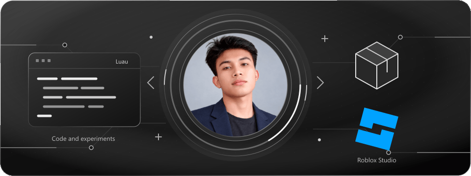
  </picture>

<h1 align="center">Cresmar Mat-an</h1>

Software developer from the Philippines.

Passionate about making cool and useful stuff. I’m a developer at heart who loves the thrill of starting with a blank file and turning it into something functional. Always learning, constantly experimenting, and driven by a genuine love for making things that work.

  
  
  
  

<h2 align="center">Languages and tools</h2>

<h3 align="center">Roblox</h3>

  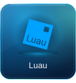
  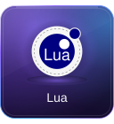
  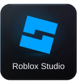
  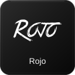

<h3 align="center">Web</h3>

  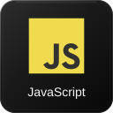
  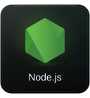
  
  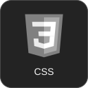
  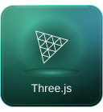

<h3 align="center">Other languages and version control</h3>

  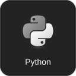
  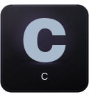
  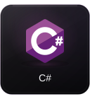
  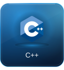
  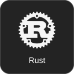
  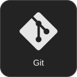

